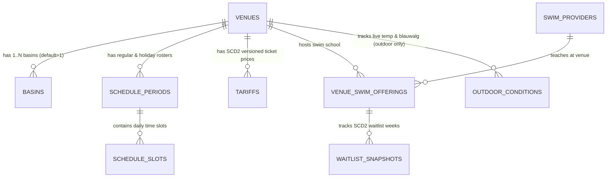

# Database Schema For Dummies (`database-context/`) 🗄️🏊‍♂️

> **Goal:** Understand the entire **AlleZwembaden.nl** SQLite / Cloudflare D1 database in 3 minutes before looking at [`schema-detailed.sql`](file:///Users/sramzzs4d/Projects-sramzz/swimming/database-context/schema-detailed.sql).

---

## 1. The Core 3-Entity Grain (Why We Don't Put Everything in One `pools` Table)

In the real Dutch swimming world, three things are often confused as "a pool":
1. **A Building / Location (`venues`):** e.g., *Zwemcentrum De Mirandabad* at De Mirandalaan 9, Amsterdam (`lat`, `lng`, postcode `1079 PA`, municipality `Amsterdam`, school holiday region `noord`, parking/OV info, Google Maps `<iframe>` URL).
2. **A Water Basin inside that Location (`basins`):** *De Mirandabad* has a **50m Wedstrijdbad (`27.8°C`)**, a **Subtropisch Golfslagbad (`31.0°C`)**, a **Peuterbad (`32.5°C`)**, and a **Buitenbad (open May–Sept)**.
   * Why separate `basins`? Because **water temperature**, **water treatment (`Zoutelektrolyse` vs. `Klassiek Chloor` vs. `Natuurwater`)**, and **lane length (25m vs. 50m)** belong to the basin!
   * *Pragmatic rule:* If a simple pool doesn't list separate basins on its website, we automatically create 1 default basin (`is_default_basin = 1`) so we never get stuck.
3. **A Swim School Offering Lessons at that Location (`swim_providers` & `venue_swim_offerings`):**
   * Often, a municipal pool runs its own lessons (with an 18-week waitlist) **while** 2 private commercial swim schools (*Zwemschool De Dolfijn*, etc.) rent lanes in that exact same pool on weekends (with a 4-week waitlist!).
   * Separating `venue_swim_offerings` lets us compare waitlists and prices per swim school at each location!

---

## 2. How History Works (Slowly Changing Dimensions — SCD Type 2)

Instead of overwriting old prices, schedules, or waitlists when a new season starts, we use **SCD Type 2** (`valid_from`, `valid_to`, `is_current`):
* **`tariffs` (Prices):** When Amsterdam raises *De Mirandabad*'s single ticket from `€ 8,20` (2025) to `€ 8,60` (2026), we close the 2025 row (`valid_to = '2025-12-31'`, `is_current = 0`) and insert the 2026 row (`valid_from = '2026-01-01'`, `is_current = 1`).
* **`waitlist_snapshots` (*Zwem-ABC* Waitlists):** Every time a waitlist changes (e.g., Diploma A drops from `8 weeks` to `4 weeks`), we append a new snapshot so we can show trends over time.
* **`schedule_periods` (Regular vs. Holiday / Vacation Rosters):**
  * Each schedule period has a `schedule_type` (`REGULAR_WINTER`, `REGULAR_SUMMER`, `SCHOOL_VACATION`, `PUBLIC_HOLIDAY`), `valid_from`, `valid_to`, `priority`, and a **Verification FSM** (`VERIFIED_PUBLISHED` | `CONFIRMED_REGULAR` | `UNCONFIRMED_FALLBACK`).
  * This lets us scrape a pool's *Herfstvakantierooster* **14 days in advance** and display both this week's hours and next week's holiday hours simultaneously!

---

## 3. How the Dutch Calendar & Weather Context Tables Work

Three tiny reference tables power automatic user warnings across the entire site:
1. **`nl_public_holidays` (*Feestdagen*):** Koningsdag, Pasen, Pinksteren, Kerst, etc.
2. **`nl_school_vacations` (*Schoolvakanties*):** Official Rijksoverheid dates per region (`noord`, `midden`, `zuid`). Every `venue` knows its region via its municipality!
3. **`weather_alerts` (*KNMI Code Oranje / Rood*):** Active provincial weather warnings synced from KNMI.

---

## 4. How Day-1 Leads, Clicks & Quarantine Logs Work

* **`lead_requests`:** Stores parents' *"Kortste Wachttijd Vergelijker & Alert"* requests (AVG-minimal: only parent email, PC4 postcode, child age in years, target diploma `A/B/C`, and preferred days—never child full name or exact DOB) governed by an explicit **Lead FSM**.
* **`outbound_clicks`:** Counts every click on *"Koop Tickets op Officiële Website ↗"* and *"Direct inschrijven bij Zwemschool ↗"* so we have hard demand proof when approaching B2B swim school partners later.
* **`ingestion_runs` & `quarantined_anomalies`:** Tracks every scraper execution, SHA-256 content hash, and quarantined failure alongside the files in [`logs/`](file:///Users/sramzzs4d/Projects-sramzz/swimming/logs/).

👉 **Want the exact column types, indexes, and SQL `CHECK` constraints?** Open **[`schema-detailed.sql`](file:///Users/sramzzs4d/Projects-sramzz/swimming/database-context/schema-detailed.sql)**.
