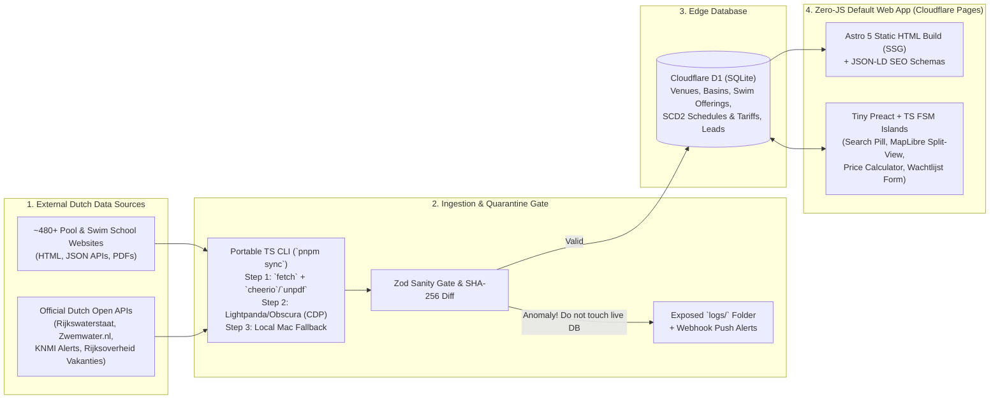

# AlleZwembaden.nl — Project For Dummies 🏊‍♂️

If you have 5 minutes and zero prior context, this guide explains **what** AlleZwembaden.nl does, **how** its pieces fit together, and **why** it is built this way.

---

## 1. The Big Picture: What Problem Do We Solve?

Imagine three people in the Netherlands on a Tuesday afternoon:
1. **Sanne (Parent in Amsterdam-Zuid):** Wants her 4.5-year-old to start *Zwemdiploma A* lessons. Municipal pool websites hide their waitlists, private swim schools rent lanes inside municipal pools with totally different prices, and her child has eczema so she prefers **saltwater electrolysis (`Zoutelektrolyse`)** over heavy chlorine.
2. **Mark (Lap Swimmer in Utrecht):** Wants to swim 50m lanes (*banenzwemmen*) tonight at 20:00 and wants to know if a *10-badenkaart* is cheaper than single tickets—and whether the pool is on a special *Herfstvakantierooster* this week.
3. **Eva (Open-Water Swimmer at Gaasperplas):** Wants to know if the water temperature dropped below `15°C` (meaning she needs a 4mm wetsuit and swim buoy) and whether there is an official *blauwalg* (blue-green algae) or *KNMI Code Oranje* warning.

**AlleZwembaden.nl** brings all of that into one fast, Airbnb-style Dutch directory.

---

## 2. How the System is Connected (End-to-End Flow)

---

## 3. The 5 Golden Rules of Our Architecture

1. **Impossible to Get a Surprise DDoS Bill (€0 Protection):**
   * All pool pages (`/zwembad/amsterdam/de-mirandabad`) and city pages (`/steden/amsterdam/banenzwemmen`) are pre-rendered as **static HTML** on Cloudflare Pages (where static bandwidth is **100% free and unlimited**).
   * Any dynamic read (like outdoor water temperatures) is cached at the Cloudflare CDN edge (`s-maxage=1800`), so 1,000,000 hits only query the database **once**.
   * Form submissions are guarded by **Cloudflare WAF Rate Limiting + Turnstile**.
2. **Indoor vs. Outdoor Water Temperature Split:**
   * **Indoor pools (`Binnenbaden`)** have fixed target temperatures per basin (*Wedstrijdbad*: `27.8°C`, *Golfslagbad*: `31.0°C`, *Peuterbad*: `32.5°C`). That is static metadata.
   * **Outdoor pools & Open water (`Buitenwater`)** have fluctuating weather-driven temperatures (`14.2°C`) synced from `Rijkswaterstaat` / `Zwemwater.nl`.
3. **Why Pool Schedules Change (The Dutch Context Engine):**
   * Pool rosters rarely change randomly. They change for:
     1. **Dutch Public Holidays (*Feestdagen*)**
     2. **Regional School Vacations (*Schoolvakanties Regio Noord, Midden, Zuid*)**
     3. **Severe Weather (*KNMI Code Oranje / Rood*) or Summer Season Transitions**
   * Two weeks before a regional vacation or season change, our scraper runs a targeted check to capture the newly published *Vakantierooster*.
4. **Never Overwrite Live Data with a Broken Scrape (Quarantine Gate):**
   * If a pool redesigns its website and our scraper reads `€ 0,00` or `0 opening hours`, the **Sanity Gate** rejects the update, keeps the existing verified data live on the website, saves the broken HTML to `logs/anomalies/`, and sends a **Webhook Push Alert** with a 1-line command you can run on your Mac to fix it.
5. **Finite State Machines (FSMs) Everywhere State Changes:**
   * Whether it is a parent submitting the *Kortste Wachttijd* form in the browser, a schedule transitioning from `UNCONFIRMED_FALLBACK` to `VERIFIED_PUBLISHED`, or an anomaly alert entering a 24-hour cooldown, explicit state machines prevent race conditions and impossible states.

---

## 4. Folder Map

* [`PHILOSOPHY.md`](file:///Users/sramzzs4d/Projects-sramzz/swimming/PHILOSOPHY.md) — How we think, code, test (TDD), log, and document.
* [`DesignMockups/`](file:///Users/sramzzs4d/Projects-sramzz/swimming/DesignMockups/) — Approved Light & Dark theme `DESIGN.md` tokens and reference HTML/screenshots.
* [`database-context/`](file:///Users/sramzzs4d/Projects-sramzz/swimming/database-context/) — [`SCHEMA_FOR_DUMMIES.md`](file:///Users/sramzzs4d/Projects-sramzz/swimming/database-context/SCHEMA_FOR_DUMMIES.md), full SQLite/D1 DDL ([`schema-detailed.sql`](file:///Users/sramzzs4d/Projects-sramzz/swimming/database-context/schema-detailed.sql)), and [`run-history.md`](file:///Users/sramzzs4d/Projects-sramzz/swimming/database-context/run-history.md).
* [`docs/steering/`](file:///Users/sramzzs4d/Projects-sramzz/swimming/docs/steering/) — High-level product roadmap & vision (the *what*, not the *how*).
* [`docs/specs/`](file:///Users/sramzzs4d/Projects-sramzz/swimming/docs/specs/) — Detailed functional & technical specifications.
* [`docs/MADRs/`](file:///Users/sramzzs4d/Projects-sramzz/swimming/docs/MADRs/) — Architectural Decision Records explaining *why* we chose each tool and rejected alternatives.
* [`docs/runbooks/`](file:///Users/sramzzs4d/Projects-sramzz/swimming/docs/runbooks/) — Step-by-step operational guides for fixing quarantined scrapes locally.
* [`docs/lessons/`](file:///Users/sramzzs4d/Projects-sramzz/swimming/docs/lessons/) — Post-mortems and lessons learned (we pay for a mistake only once).
* [`logs/`](file:///Users/sramzzs4d/Projects-sramzz/swimming/logs/) — Exposed human-readable + JSONL run logs and quarantined HTML snapshots.
