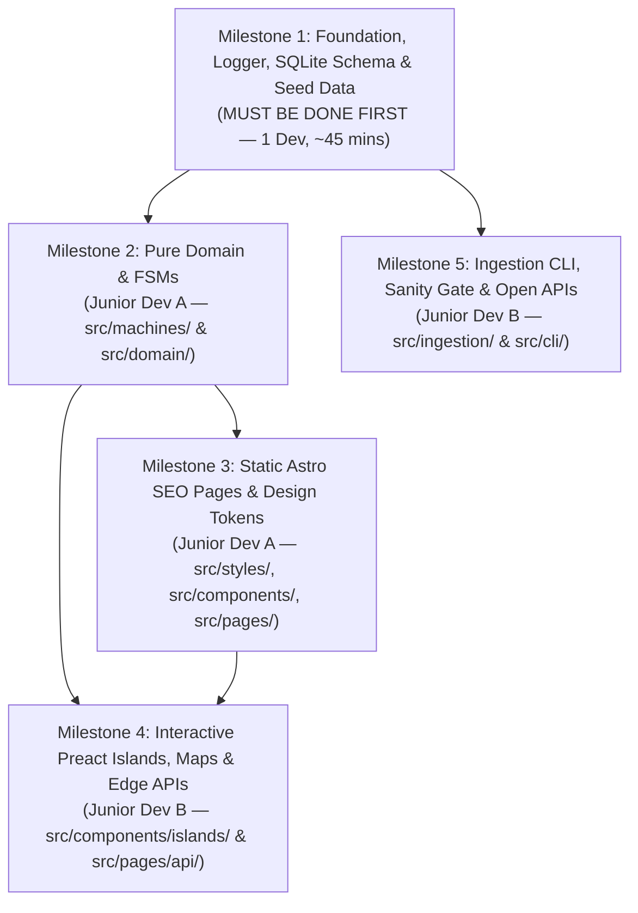

# AlleZwembaden.nl — Master Implementation Plan (`000`)

> **For agentic workers & Junior developers:** REQUIRED SUB-SKILL: Use `superpowers:subagent-driven-development` (recommended) or `superpowers:executing-plans` to implement this plan task-by-task. Steps use checkbox (`- [ ]`) syntax for tracking.

**Goal:** Build and verify the complete **AlleZwembaden.nl** Dutch swimming directory, *Zwem-ABC* waitlist comparator, Dutch holiday/weather schedule resolver, and quarantined ingestion pipeline across 5 testable milestones.

**Architecture:** Static-first **Astro 5 (TypeScript)** web application styled with **Tailwind CSS v4 (`Aquatic Discovery` tokens)**, backed by **Cloudflare D1 (SQLite)**, isolated **Preact (3 KB) + Pure TypeScript Finite State Machine** islands, a **Zero-Cost Hybrid Map** (Google Maps lazy `<iframe>` on Detail pages + MapLibre GL with OpenFreeMap/PDOK vector tiles on Search Split-View), and a **Portable TypeScript Ingestion CLI** (`fetch` $\rightarrow$ `Lightpanda`/`Obscura` CDP $\rightarrow$ Local Mac fallback) guarded by a **Zod Sanity Gate**.

**Tech Stack:** TypeScript, Astro 5 (`@astrojs/cloudflare`, `@astrojs/preact`, `@astrojs/check`), Tailwind CSS v4, **Cloudflare `cf` CLI (`cloudflare.config.ts`)**, **Oxlint (`oxlint` Rust linter)**, Cloudflare D1 / `better-sqlite3` (local dev & TDD), Vitest, Zod, MapLibre GL JS, Cheerio, `unpdf`, `playwright-core` (CDP for Lightpanda/Obscura).

---

## Where to Start & Local Prerequisites

### 1. Required Local Tools & Accounts (Check Before Starting!)
👉 **Read First:** **[`docs/runbooks/000-preflight-accounts-and-cf-cli.md`](file:///Users/sramzzs4d/Projects-sramzz/swimming/docs/runbooks/000-preflight-accounts-and-cf-cli.md)** for the complete guide on GitHub access, `.env` setup, Cloudflare accounts, and how to use the new **Cloudflare `cf` CLI**.

Before starting **Milestone 1**, verify your machine has:
* **Node.js `>= 22.18.0`** (`node -v` — required by the new Cloudflare `cf` CLI)
* **pnpm `>= 9.0.0`** (`pnpm -v` — if missing, run `corepack enable && corepack prepare pnpm@latest --activate`)
* **Cloudflare `cf` CLI** (`pnpm add --global cf` $\rightarrow$ verify with `cf --version` or `cf cli search "create D1 database"`)
* **SQLite3 CLI** (`sqlite3 --version` — pre-installed on macOS/Linux)
* **Zero Paid Accounts Required Locally:** All local tests (`pnpm test`) and local seeding (`pnpm db:seed`) run 100% offline using local SQLite and Cloudflare's official Turnstile dummy test keys in `.env.example`.

### 2. 15-Minute Reading Order for New Juniors
Do **not** read every document at once. Read these 4 files (15 minutes total), then start coding:
1. **[`docs/runbooks/000-preflight-accounts-and-cf-cli.md`](file:///Users/sramzzs4d/Projects-sramzz/swimming/docs/runbooks/000-preflight-accounts-and-cf-cli.md)** — Setup `cf` CLI, Git branches, and `.env`.
2. **[`docs/PROJECT_FOR_DUMMIES.md`](file:///Users/sramzzs4d/Projects-sramzz/swimming/docs/PROJECT_FOR_DUMMIES.md)** — Understand what AlleZwembaden.nl does in plain English.
3. **[`database-context/SCHEMA_FOR_DUMMIES.md`](file:///Users/sramzzs4d/Projects-sramzz/swimming/database-context/SCHEMA_FOR_DUMMIES.md)** — Understand why `venues`, `basins`, and `venue_swim_offerings` are separate tables.
4. **[`docs/plans/milestone-1-foundation-and-db.md`](file:///Users/sramzzs4d/Projects-sramzz/swimming/docs/plans/milestone-1-foundation-and-db.md)** — Start at **Task 1.1, Step 1**.

### 3. How a Team of Juniors Can Split the Work (Dependency Graph)


* **Step 1 (Everyone / Lead Junior):** Complete **[Milestone 1](file:///Users/sramzzs4d/Projects-sramzz/swimming/docs/plans/milestone-1-foundation-and-db.md)** first and merge it to `main`. It creates `package.json`, the logger (`src/lib/logger.ts`), the SQLite database (`src/db/client.ts`), and the seed data (`src/db/seed.ts`).
* **Step 2 (Parallel Track):** Once Milestone 1's Gate passes:
  * **Junior A** works on **[Milestone 2](file:///Users/sramzzs4d/Projects-sramzz/swimming/docs/plans/milestone-2-core-domain-fsms-and-context.md)** (`src/machines/` and `src/domain/`).
  * **Junior B** can simultaneously work on **[Milestone 5](file:///Users/sramzzs4d/Projects-sramzz/swimming/docs/plans/milestone-5-ingestion-cli-and-observability.md)** (`src/ingestion/` and `src/cli/`), because Milestone 5 only depends on Milestone 1's logger and database!
* **Step 3 (UI & Islands Track):** Once Milestone 2 passes:
  * **Junior A** builds **[Milestone 3](file:///Users/sramzzs4d/Projects-sramzz/swimming/docs/plans/milestone-3-seo-frontend-and-design-system.md)** (Tailwind v4 tokens, static `.astro` components, and zero-JS SEO pages).
  * **Junior B** builds **[Milestone 4](file:///Users/sramzzs4d/Projects-sramzz/swimming/docs/plans/milestone-4-interactive-islands-and-maps.md)** (Preact interactive islands in `src/components/islands/` and API endpoints in `src/pages/api/`).

---

## Golden Rules for Junior Developers (Read Before Starting!)

1. **Test-Driven Development (TDD) is Mandatory ([`PHILOSOPHY.md`](file:///Users/sramzzs4d/Projects-sramzz/swimming/PHILOSOPHY.md#L35)):**
   * Always follow the 5-step loop in every task:
     1. Write the failing test (`*.test.ts`)
     2. Run `pnpm test` and watch it **FAIL** for the expected reason
     3. Write the minimal implementation code
     4. Run `pnpm test` and watch it **PASS**
     5. Commit your small, working change
2. **Command-Query Separation (CQS):**
   * A function either **mutates state** (Command) or **returns data** (Query)—never both.
3. **Use the Cloudflare `cf` CLI (`cloudflare.config.ts`) for All Cloudflare Operations:**
   * Never hand-edit legacy `wrangler.toml` files. Use `cf dev`, `cf build`, `cf deploy`, `cf d1`, and `cf cli search "<query>"` as documented in [`docs/runbooks/000-preflight-accounts-and-cf-cli.md`](file:///Users/sramzzs4d/Projects-sramzz/swimming/docs/runbooks/000-preflight-accounts-and-cf-cli.md).
4. **Stop at Every Milestone Gate:**
   * Do **not** start Milestone $N+1$ until **every checkbox** in Milestone $N$'s Verification Gate passes.
5. **Never Touch Live Data Without the Sanity Gate:**
   * All database sync scripts must log to [`logs/runs/`](file:///Users/sramzzs4d/Projects-sramzz/swimming/logs/) and update [`database-context/run-history.md`](file:///Users/sramzzs4d/Projects-sramzz/swimming/database-context/run-history.md).

---

## ✅ The Checkbox Contract: Definition of Done (When Can a Junior Mark `[x]`?)

A checkbox (`- [ ]` $\rightarrow$ `- [x]`) is **not** a "I pasted the code" marker. It is a **verified engineering contract**. You may only mark a checkbox `[x]` when **all** of the following are true:

### 1. For a Step Checkbox inside a Milestone File (`- [ ] Step N: ...`)
* **Step 1 (Write Failing Test):** The test file exists at the exact path, compiles without syntax errors, and describes the real business invariant.
* **Step 2 (Verify Red / Fail):** You actually ran the `pnpm test <path>` command in your terminal and confirmed it failed because the feature is not implemented yet (not because of a typo in imports).
* **Step 3 (Implement Code):** The implementation file exists at the exact path, passes **`pnpm lint` (`oxlint --deny-warnings`)** with **zero** `any` casts or warnings, and follows CQS (Commands vs. Queries).
* **Step 4 (Verify Green / Pass):** You ran `pnpm test <path>` and `pnpm lint` in your terminal and saw `PASS` with `0` errors/warnings.
* **Step 5 (Commit & Tick):** You ran the `git commit` command, updated `- [ ]` to `- [x]` in the milestone `.md` file, and `git status` shows a clean working tree.

### 2. For a Task Checkbox in `000-master-implementation-plan.md` (`- [ ] Task X.Y: ...`)
* Every individual Step (`Step 1` through `Step 5`) inside `Task X.Y` in the milestone plan is marked `[x]`.
* Every item in that task's **`✅ Definition of Done (DoD)`** callout box is verified.
* Both `pnpm lint` (`oxlint`) and full test suite (`pnpm test`) pass with `0` warnings and `0` regressions.

### 3. For a Milestone Gate Checkbox (`- [ ] 🛑 Milestone N Gate Verification`)
* Every Task in Milestone $N$ is `[x]`.
* You ran `pnpm check` (`oxlint` + `astro check`), `pnpm test`, and every command in the **Milestone $N$ Verification Gate** section at the bottom of the milestone document and pasted the passing terminal output into your Pull Request description.

---

## Repository File Structure Map

```text
/Users/sramzzs4d/Projects-sramzz/swimming/
├── package.json
├── tsconfig.json
├── .oxlintrc.json                           # Oxlint Rust linter config (TypeScript, jsx-a11y, Vitest)
├── astro.config.mjs
├── vitest.config.ts
├── cloudflare.config.ts                     # Typed Cloudflare `cf` CLI configuration (Workers + D1 bindings)
├── .env.example                             # Safe local defaults & Turnstile dummy test keys
├── database-context/
│   ├── SCHEMA_FOR_DUMMIES.md
│   ├── schema-detailed.sql
│   ├── run-history.md
│   └── manual-overrides/
├── logs/
│   ├── runs/
│   └── anomalies/
├── src/
│   ├── lib/
│   │   └── logger.ts                        # Dual human (.log) + JSONL (.jsonl) logger
│   ├── db/
│   │   ├── client.ts                        # SQLite / Cloudflare D1 database wrapper
│   │   ├── geo.ts                           # Bounding-box + Haversine PC4 radius search (<0.5ms)
│   │   ├── queries.ts                       # Read queries (Venues, Basins, Schedules, Tariffs, Offerings)
│   │   └── seed.ts                          # Idempotent Randstad Gold-Standard + NL Baseline seeder
│   ├── machines/
│   │   ├── schedule-resolver.ts             # FSM: Feestdagen, Schoolvakanties (Noord/Midden/Zuid), KNMI
│   │   ├── sticky-widget-machine.ts         # FSM: Price Calculator + Day-1 Waitlist Comparator form
│   │   └── alert-cooldown-machine.ts        # FSM: 24h deduplication for Quarantine Webhook alerts
│   ├── domain/
│   │   ├── open-status.ts                   # Zero-request client clock ('Nu Open' in Europe/Amsterdam)
│   │   ├── seo-aggregator.ts                # Soft-404 gate, City summary stats, JSON-LD & True-Diff lastmod
│   │   └── affiliate-stub.ts                # Security-hardened allowlist stub (disabled by default)
│   ├── styles/
│   │   └── global.css                       # Tailwind v4 @theme tokens (Aquatic Discovery Light & Dark)
│   ├── layouts/
│   │   └── BaseLayout.astro                 # SEO meta, canonical URL, JSON-LD, Speculation Rules
│   ├── components/
│   │   ├── Header.astro                     # Top navbar & 3-segment search trigger
│   │   ├── Footer.astro                     # KNZB/NRZ accreditation footer
│   │   ├── TrustBanner.astro                # Rijkswaterstaat / NRZ verification banner
│   │   ├── WaterTreatmentBadge.astro        # Zoutelektrolyse vs. Klassiek Chloor vs. Natuurwater pill
│   │   ├── AlertBanner.astro                # KNMI Code Oranje / Schoolvakantie / Blauwalg banner
│   │   ├── VenueCard.astro                  # Airbnb-style 20:19 listing card
│   │   ├── LazyGoogleMapIframe.astro        # Zero-initial-JS Google Maps <iframe> facade for Detail page
│   │   └── islands/
│   │       ├── SearchAndFilterIsland.tsx    # 3-segment search + canonicalized micro-filters
│   │       ├── ListingMapIsland.tsx         # MapLibre GL + OpenFreeMap/PDOK + HTML price/waitlist pills
│   │       └── StickyBookingWidgetIsland.tsx # Calculator (Tab 1) + Kortste Wachttijd form (Tab 2)
│   ├── pages/
│   │   ├── index.astro                      # Homepage Split-View (58% cards / 42% sticky map)
│   │   ├── sitemap.xml.ts                   # True-Diff <lastmod> sitemap with Soft-404 gate
│   │   ├── zwembad/[stad]/[slug].astro      # Facility Detail Page (e.g. De Mirandabad)
│   │   ├── steden/[stad]/
│   │   │   ├── index.astro                  # City Overview
│   │   │   ├── banenzwemmen.astro           # City Banenzwemmen Timetable & 10-Badenkaart comparison
│   │   │   ├── zwemles.astro                # City Zwem-ABC Waitlist Ranking
│   │   │   └── buitenwater.astro            # City Outdoor & Open-Water Temperatures
│   │   └── api/
│   │       ├── health.ts                    # /api/health readiness endpoint for Uptime Kuma
│   │       ├── leads.ts                     # Turnstile + Idempotent Day-1 Waitlist Alert endpoint
│   │       └── clicks.ts                    # Outbound ticket/signup click counter
│   ├── ingestion/
│   │   ├── sanity-gate.ts                   # SHA-256 diff + Zod Sanity invariants + Quarantine snapshotter
│   │   ├── fetcher.ts                       # 3-Step Escalation: fetch -> Lightpanda/Obscura CDP -> Local
│   │   ├── open-apis.ts                     # Rijksoverheid Vakanties, KNMI, Rijkswaterstaat syncers
│   │   └── alert-dispatcher.ts              # Webhook Push (Telegram/Discord/Slack/ntfy) dispatcher
│   └── cli/
│       └── sync.ts                          # Portable CLI (`pnpm sync:venue`, `pnpm sync:scheduled`)
└── tests/                                   # Vitest TDD test suite mirroring src/
```

---

## Milestone Checklist & Gate Tracker

### [Milestone 1: Foundation, Logger, SQLite/D1 Schema & Seed Data](file:///Users/sramzzs4d/Projects-sramzz/swimming/docs/plans/milestone-1-foundation-and-db.md)
- [x] **Task 1.1:** Initialize Project Dependencies, TypeScript, Astro 5, Tailwind v4 & Vitest
- [x] **Task 1.2:** Build Dual-Format Logger (`src/lib/logger.ts`) writing `.log` + `.jsonl` to `logs/runs/`
- [x] **Task 1.3:** Build SQLite/D1 Client & Schema Migration Runner (`src/db/client.ts`)
- [x] **Task 1.4:** Build Bounding-Box + Haversine Geospatial Search (`src/db/geo.ts`)
- [x] **Task 1.5:** Build Idempotent Seeder (`src/db/seed.ts`) & Data Access Queries (`src/db/queries.ts`)
- [x] **🛑 Milestone 1 Gate Verification:** `pnpm test` passes, local DB seeded with Randstad Gold-Standard venues (*De Mirandabad*, *Sportfondsenbad Oost*, *De Dolfijn*, *Gaasperplas*, *R&A Utrecht*, *Tongelreep Eindhoven*), and `logs/runs/` contains the seed log.

### [Milestone 2: Core Domain Engines & Finite State Machines](file:///Users/sramzzs4d/Projects-sramzz/swimming/docs/plans/milestone-2-core-domain-fsms-and-context.md)
- [x] **Task 2.1:** Build Dutch Context & Schedule Resolver FSM (`src/machines/schedule-resolver.ts`)
- [x] **Task 2.2:** Build Zero-Request Client Clock & "Nu Open" Evaluator (`src/domain/open-status.ts`)
- [x] **Task 2.3:** Build Sticky Price Calculator & Lead Capture FSM (`src/machines/sticky-widget-machine.ts`)
- [x] **Task 2.4:** Build SEO Quality Gate, City Summary Generator & JSON-LD Builder (`src/domain/seo-aggregator.ts`)
- [x] **Task 2.5:** Build Security-Hardened Affiliate Gear Stub (`src/domain/affiliate-stub.ts`)
- [x] **🛑 Milestone 2 Gate Verification:** All pure domain & FSM tests pass (`pnpm test tests/machines tests/domain`), verifying holiday overrides, KNMI Code Oranje alerts, price break-even math, and Soft-404 prevention.

### [Milestone 3: `Aquatic Discovery` Design System & Zero-JS SEO Pages](file:///Users/sramzzs4d/Projects-sramzz/swimming/docs/plans/milestone-3-seo-frontend-and-design-system.md)
- [x] **Task 3.1:** Configure Tailwind CSS v4 `Aquatic Discovery` Tokens & `BaseLayout.astro` (with Speculation Rules)
- [x] **Task 3.2:** Build Static Design System Components (`Header`, `Footer`, `WaterTreatmentBadge`, `AlertBanner`, `VenueCard`, `LazyGoogleMapIframe`)
- [x] **Task 3.3:** Build Facility Detail Page (`src/pages/zwembad/[stad]/[slug].astro`)
- [x] **Task 3.4:** Build Homepage (`src/pages/index.astro`), Tier-1 City Intent Pages (`src/pages/steden/[stad]/...`), and True-Diff `sitemap.xml.ts`
- [x] **🛑 Milestone 3 Gate Verification:** `pnpm build` succeeds with 0 errors, generated HTML contains valid `JSON-LD` and `<link rel="canonical">`, and empty city-intent combinations are excluded by the Soft-404 gate.

### [Milestone 4: Interactive Preact Islands, Hybrid Maps & Edge APIs](file:///Users/sramzzs4d/Projects-sramzz/swimming/docs/plans/milestone-4-interactive-islands-and-maps.md)
- [x] **Task 4.1:** Build Listing Split-View Map Island (`src/components/islands/ListingMapIsland.tsx` with MapLibre GL + OpenFreeMap/PDOK)
- [x] **Task 4.2:** Build 3-Segment Search & Canonicalized Micro-Filter Island (`src/components/islands/SearchAndFilterIsland.tsx`)
- [x] **Task 4.3:** Build Sticky Price Calculator & *Kortste Wachttijd* Lead Widget Island (`src/components/islands/StickyBookingWidgetIsland.tsx`)
- [x] **Task 4.4:** Build Edge API Endpoints (`/api/health`, `/api/leads`, `/api/clicks`) with Turnstile, Zod & Idempotency
- [x] **🛑 Milestone 4 Gate Verification:** All API & Island tests pass, `/api/health` returns `200 OK`, duplicate lead submissions with the same `idempotency_key` do not create duplicate rows.

### [Milestone 5: Portable Ingestion CLI, Lightpanda/Obscura CDP, Quarantine Gate & Alerts](file:///Users/sramzzs4d/Projects-sramzz/swimming/docs/plans/milestone-5-ingestion-cli-and-observability.md)
- [x] **Task 5.1:** Build SHA-256 Content-Hash Diff & Zod Sanity Quarantine Gate (`src/ingestion/sanity-gate.ts`)
- [x] **Task 5.2:** Build 3-Step Escalation Fetcher (`fetch` $\rightarrow$ `Lightpanda`/`Obscura` CDP $\rightarrow$ Local Override) (`src/ingestion/fetcher.ts`)
- [x] **Task 5.3:** Build Dutch Open Data Syncers (Rijksoverheid Vakanties, KNMI, Rijkswaterstaat) (`src/ingestion/open-apis.ts`)
- [x] **Task 5.4:** Build Webhook Push Alert Dispatcher with 24h Cooldown (`src/ingestion/alert-dispatcher.ts`) & Portable CLI (`src/cli/sync.ts`)
- [x] **🛑 Milestone 5 Gate Verification:** Simulated broken pool scrape (`€ 0,00` ticket price) is blocked from touching live DB, raw HTML snapshot is saved to `logs/anomalies/`, and Webhook payload includes the exact `pnpm sync:venue --slug=...` Mac recovery command.

### [Milestone 6: Full Page Wiring, Mockup Polish, Multi-Account `cf` CLI Guardrail & CI/CD](file:///Users/sramzzs4d/Projects-sramzz/swimming/docs/plans/milestone-6-page-wiring-and-production-readiness.md)
- [x] **Task 6.1:** Git Hygiene (`.gitignore`), Run-History Updater (`database-context/run-history.md`), and Multi-Account `cf` CLI Profile Guardrail (`src/cli/verify-cf-profile.ts` enforcing `--profile allezwembaden`)
- [ ] **Task 6.2:** Wire Homepage Split-View (`58%` Cards / `42%` Sticky Map) & Interactive Filter Bar (`src/pages/index.astro`)
- [ ] **Task 6.3:** Wire Facility Detail Page (`src/pages/zwembad/[stad]/[slug].astro`) with `StickyBookingWidgetIsland`, `<AlertBanner />`, *Banenzwemmen* Timetable & Transit Chips
- [ ] **Task 6.4:** Expose `/api/health.json` Endpoint & GitHub Actions CI + Daily Sync Workflows (`.github/workflows/ci.yml` & `.github/workflows/daily-sync.yml`)
- [ ] **🛑 Milestone 6 Gate Verification:** `pnpm check && pnpm test && pnpm build` passes with 18 generated routes, islands are mounted on `/` and `/zwembad/[stad]/[slug]`, and `pnpm cf:profile:check` prevents accidental deployment to the `default` Cloudflare account.
