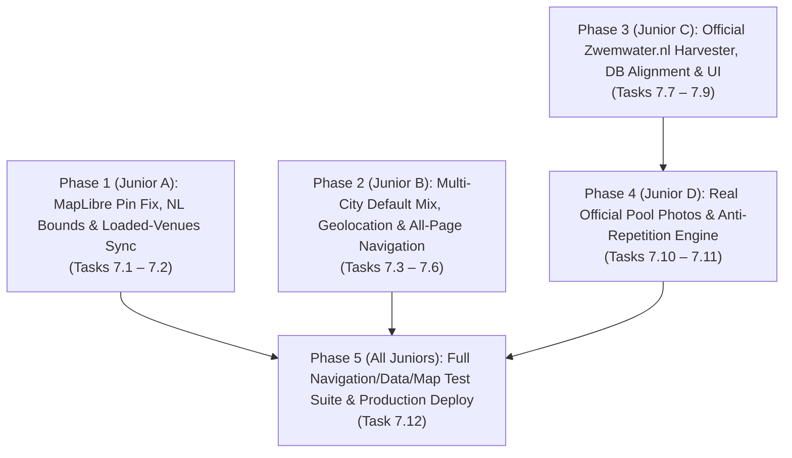

# Milestone 7 Recovery Plan: Real Official Photos, Navigation Integrity, Multi-City Discovery, MapLibre Pin Fix & Full Zwemwater.nl Alignment

> **For Junior Developers & Agentic Workers:**
> Follow [`PHILOSOPHY.md`](file:///Users/sramzzs4d/Projects-sramzz/swimming/PHILOSOPHY.md) strictly: **Reliable software builds trust — trust is our biggest asset.**
> Every task below follows **TDD with intent** (Red $\rightarrow$ Green $\rightarrow$ Verify/Expand Tests $\rightarrow$ Commit & Tick `[x]`), **KISS**, **POLA (Principle of Least Astonishment)**, **CQS (Command-Query Separation)**, and **Idempotency**.
> Read [`docs/lessons/frontend-islands-and-maplibre.md`](file:///Users/sramzzs4d/Projects-sramzz/swimming/docs/lessons/frontend-islands-and-maplibre.md) and [`docs/lessons/sqlite-d1-and-data.md`](file:///Users/sramzzs4d/Projects-sramzz/swimming/docs/lessons/sqlite-d1-and-data.md) before starting!

---

## Executive Summary: The 5 Production Regressions We Are Fixing

1. **Issue #1 — Repetitive & Inaccurate Venue Photos:**
   - **Problem:** Only 32 generic stock photos were hashed across 1,002 venues, causing visible repetition on the homepage/city grids and showing generic photos instead of the real swimming pools and lakes.
   - **Fix:** Harvest real photographs of all 57 curated/flagship pools from their official websites (`official_website_url` `og:image`/hero images) and Wikimedia Commons into `public/images/venues/official/<slug>.webp`, harvest official `https://register.zwemwater.nl/zwr/api/files/<id>` photos (`Foto1`, `Foto2`) for outdoor bathing spots, and enforce a strict **zero-repetition guarantee** across the top 24 cards on the homepage and city pages.
2. **Issue #2 — Dead Links, Unwired Header Buttons & Broken Card/Cart Actions:**
   - **Problem:**
     - `Word Aanbieder` in `Header.astro` pointed to `/#aanbieder` (non-existent).
     - The Globe button (`Taalkeuze`) in `Header.astro` had no click handler.
     - The User Menu / Favorites pill in `Header.astro` pointed to `/#favorieten` (non-existent).
     - On Pool Detail pages (`/zwembad/[stad]/[slug]`), the right-hand booking/cart widget (`StickyBookingWidgetIsland.tsx`) checked `official_tickets_url` (which was `null` for 996 of 1,002 venues) without falling back to `official_website_url`, and rendered a fake `€ 0,00` ticket calculator on natural open-water lakes (`OPEN_WATER_NATURAL`) where no tickets or swim lessons exist.
   - **Fix:** Audit and wire **every** navigation link and button across all 6 page types (`/`, `/aanbieder`, `/steden`, `/steden/[stad]`, `/steden/[stad]/[intent]`, `/provincies/[provincie]`, `/zwembad/[stad]/[slug]`), build `/aanbieder` and `/steden`, wire the Globe Region/Language Modal and Saved Favorites Drawer in `Header.astro`, and give `StickyBookingWidgetIsland.tsx` an Open-Water Zwemwater.nl Dossier mode + `official_website_url` fallback.
3. **Issue #3 — Hardcoded Amsterdam Bias Instead of Multi-City & Geolocation Discovery:**
   - **Problem:** The homepage defaulted to 4 Amsterdam pools first, the map was locked to `"Amsterdam & Randstad"` (`[4.9021, 52.345]`), and the header links only pointed to `/steden/amsterdam/...`.
   - **Fix:** Curate a diverse national default mix (`Heel Nederland` showcasing Amsterdam, Rotterdam, Utrecht, Eindhoven, Den Haag, Wassenaar, Groningen, Maastricht, Deventer, Apeldoorn, Tilburg, Breda), add a **Quick City & `"📍 Dichtbij mij"` Geolocation Switcher Bar** (`navigator.geolocation` + Haversine sorting), and update the header/footer to surface all major Dutch cities and 12 provinces.
4. **Issue #4 — MapLibre Showing Pins in Germany & Pins Disappearing on Hover:**
   - **Problem:** `ListingMapIsland.tsx` passed the `<button>` directly to `new maplibregl.Marker({ element: el })` and then overwrote `el.className = '...'` inside `useEffect([selectedVenue, hoveredVenueId])`. That stripped MapLibre's `.maplibregl-marker` class (`position: absolute; top: 0; left: 0`), reverting pins to static inline flow + `transform: translate(...)`, which pushed pins into Germany (`Hamburg`, `Berlin`, `Dresden`) and off-screen on hover! Furthermore, the map did not match the currently loaded cards on the homepage.
   - **Fix:** Wrap each marker button inside an untouched `
` passed to `maplibregl.Marker`, mutate only the inner `<button>` class on hover/selection, clamp map bounds to the Netherlands (`maxBounds: [[3.1, 50.6], [7.4, 53.7]]`), and sync map markers strictly with the **currently loaded homepage venues (`displayedVenues`)**.
5. **Issue #5 — Full Database & Website Alignment with `https://www.zwemwater.nl/`:**
   - **Problem:** `ingest-national.ts` only scraped the homepage list of `zwemwater.nl` and hardcoded `"Gratis toegang"` (`min_single_price_cents: 0`) for all 945 spots, ignoring per-spot restrictions (`Honden niet toegestaan`, `Zwemzone afgebakend`, `SEMI_OPENBAAR BETAALD`), official Information Boards (`Informatiebord`), `Zwemwaterprofiel` documents, 4-year EU water quality ratings, location managers, and active warning details from `map-content.php?spotid=<id>`.
   - **Fix:** Harvest and parse `https://www.zwemwater.nl/wp-content/themes/stuurlui/blocks/map/map-content.php?spotid=<spotid>` for all 945 official locations, store the structured `zwemwater_metadata_json` in SQLite/D1, fix paid vs. free entrance badges, and render the official restrictions, `Informatiebord`, `Zwemwaterprofiel`, active warnings, and location manager on `/zwembad/[stad]/[slug]`.

---

## How a Team of Juniors Can Split Milestone 7 (Parallel Workflow)

---

## Phase 1: MapLibre GL Recovery — Fix Pins in Germany, Disappearing Hover Pins & Loaded-Venues Sync (Issue #4)

### Task 7.1: Isolate MapLibre Marker Wrapper DOM Element & Enforce NL Geographic Bounds

> **Why ([`docs/lessons/frontend-islands-and-maplibre.md`](file:///Users/sramzzs4d/Projects-sramzz/swimming/docs/lessons/frontend-islands-and-maplibre.md)):**
> MapLibre GL attaches `.maplibregl-marker` (`position: absolute; top: 0; left: 0`) and `style="transform: translate(...)"` to the root element passed to `new maplibregl.Marker({ element })`. Overwriting `.className` on that root element strips `maplibregl-marker` and scatters pins into Germany and off-screen when hovering!

**Files:**
- Create: `src/domain/map-bounds.ts`
- Modify: `src/components/islands/ListingMapIsland.tsx`
- Create: `tests/components/islands/listing-map-island.test.ts`

- [x] **Step 1 (Write Failing Test):** Create `tests/components/islands/listing-map-island.test.ts` testing:
  1. `isWithinNetherlandsBounds(lat, lng)` accepts valid Dutch coordinates (`52.345, 4.9021`) and rejects German/out-of-bounds coordinates (`52.52, 13.405` Berlin, `53.55, 9.99` Hamburg).
  2. `filterValidMapVenues(venues)` filters out any venue outside the Netherlands bounding box (`50.7 <= lat <= 53.6`, `3.3 <= lng <= 7.25`).
  3. `createMapMarkerDomElement(venue, isSelected, isHovered)` returns `{ wrapperEl, buttonEl }` where `wrapperEl` preserves any class added by MapLibre (`maplibregl-marker`) even after `updateMapMarkerButtonState(buttonEl, isSelected, isHovered)` is called repeatedly on hover/unhover.
- [x] **Step 2 (Verify Red):** Run `pnpm test tests/components/islands/listing-map-island.test.ts` and confirm it fails.
- [x] **Step 3 (Implement Code):**
  - Create `src/domain/map-bounds.ts` with `NL_MAP_MAX_BOUNDS`, `NL_DEFAULT_CENTER`, `isWithinNetherlandsBounds`, `filterValidMapVenues`, `createMapMarkerDomElement`, and `updateMapMarkerButtonState`.
  - Update `src/components/islands/ListingMapIsland.tsx` to use `wrapperEl` for `new maplibregl.Marker({ element: wrapperEl, anchor: 'center' })` and `buttonEl` for hover/selected styling, plus `maxBounds: NL_MAP_MAX_BOUNDS`.
- [x] **Step 4 (Verify Green):** Run `pnpm test tests/components/islands/listing-map-island.test.ts && pnpm check`.
- [x] **Step 5 (Tick Checkbox):** Mark Task 7.1 steps `[x]`.

---

### Task 7.2: Sync Map Markers & Camera Bounds Strictly with Loaded Homepage Venues (`displayedVenues`)

> **Why (User Issue #4):**
> "Is the map suppose to show all places of only the loaded ones in the homepage. I am even seeing places in Germany. The map on first load shows the prices of all places then once you hover they disapear"
> The map must show the exact venues currently loaded in the homepage feed (`displayed = filtered.slice(0, visibleCount)`), fit the camera cleanly around those loaded venues (clamped to the Netherlands), and highlight the corresponding pin on card hover without ever hiding or shifting pins.

**Files:**
- Modify: `src/components/islands/SearchAndFilterIsland.tsx`
- Modify: `src/components/islands/ListingMapIsland.tsx`
- Modify: `tests/components/islands/listing-map-island.test.ts`

- [x] **Step 1 (Write Failing Test):** Add test cases in `tests/components/islands/listing-map-island.test.ts` verifying that `SearchAndFilterIsland` dispatches `displayedVenues` (matching `visibleCount`, e.g. 24 loaded cards) alongside `totalFilteredCount` and `activeCityLabel`, and `ListingMapIsland` renders markers only for the loaded `displayedVenues`.
- [x] **Step 2 (Verify Red):** Run `pnpm test tests/components/islands/listing-map-island.test.ts`.
- [x] **Step 3 (Implement Code):**
  - In `SearchAndFilterIsland.tsx`, pass `venues={venues.slice(0, 24)}` initially and dispatch `zwemkaart:filtered` with `{ venues: displayed, totalFiltered: filtered.length, query, cityLabel }`.
  - In `ListingMapIsland.tsx`, render markers for `displayedVenues` (all validated via `filterValidMapVenues`), fit bounds smoothly within the Netherlands, and keep `selectedVenue` optional (only open the floating preview card when the user clicks a pin or pill, or closes it cleanly with `✕`).
- [x] **Step 4 (Verify Green):** Run `pnpm test tests/components/islands/listing-map-island.test.ts && pnpm check`.
- [x] **Step 5 (Tick Checkbox):** Mark Task 7.2 steps `[x]`.

---

## Phase 2: Multi-City Default Mix, Geolocation Discovery & Header/Page Navigation Recovery (Issues #2 & #3)

### Task 7.3: Multi-City Default Homepage Ordering + Quick City & `"📍 Dichtbij mij"` Geolocation Switcher

> **Why (User Issue #3):**
> "Is the page showing Amsterdam by default or is it changing depending from where the user is browsing? If yes, fine, if not, then it is good to put different cities"
> Instead of showing 4 Amsterdam pools first and locking the header/map to Amsterdam, the default `"Aanbevolen"` view on `/` should showcase a balanced round-robin of top venues across diverse Dutch cities (Amsterdam, Rotterdam, Utrecht, Eindhoven, Den Haag, Wassenaar, Deventer, Groningen, Maastricht, Apeldoorn, Tilburg, s-Hertogenbosch) AND provide a 1-click **City & `"📍 Dichtbij mij"` Geolocation Bar** that sorts venues by real distance (`navigator.geolocation` + Haversine) or filters by city!

**Files:**
- Create: `src/domain/multi-city-ranking.ts`
- Modify: `src/components/islands/SearchAndFilterIsland.tsx`
- Create: `tests/domain/multi-city-ranking.test.ts`

- [x] **Step 1 (Write Failing Test):** Create `tests/domain/multi-city-ranking.test.ts` asserting that:
  1. `rankVenuesMultiCityRecommended(venues)` interleaves municipalities so the top 10 default homepage venues span at least **7 distinct Dutch municipalities** (no single city occupies more than 2 slots in the top 10).
  2. `rankVenuesByUserLocation(venues, userLat, userLng)` sorts venues by Haversine distance in km from the user's coordinates.
- [x] **Step 2 (Verify Red):** Run `pnpm test tests/domain/multi-city-ranking.test.ts`.
- [x] **Step 3 (Implement Code):**
  - Implement `rankVenuesMultiCityRecommended` and `rankVenuesByUserLocation` in `src/domain/multi-city-ranking.ts`.
  - Wire them into `SearchAndFilterIsland.tsx` and add the **Quick City & `"📍 Dichtbij mij"` Switcher Bar** (`Heel Nederland`, `📍 Dichtbij mij`, `Amsterdam`, `Rotterdam`, `Den Haag`, `Utrecht`, `Eindhoven`, `Groningen`, `Maastricht`, `Tilburg`, `Apeldoorn`, `Deventer`).
- [x] **Step 4 (Verify Green):** Run `pnpm test tests/domain/multi-city-ranking.test.ts && pnpm check`.
- [x] **Step 5 (Tick Checkbox):** Mark Task 7.3 steps `[x]`.

---

### Task 7.4: Create `/aanbieder` (B2B Partner Portal) and `/steden` (All Municipalities & Provinces Directory)

> **Why (User Issue #2):**
> "If I click on 'Word Aanbieder' leads to no-where."
> Every navigation item must lead to a working, valuable page.

**Files:**
- Create: `src/pages/aanbieder.astro`
- Create: `src/pages/steden/index.astro`
- Modify: `tests/pages/seo-build.test.ts`

- [x] **Step 1 (Write Failing Test):** Add tests in `tests/pages/seo-build.test.ts` verifying `src/pages/aanbieder.astro` and `src/pages/steden/index.astro` exist, render valid `<Header />`, `<Footer />`, canonical tags, and interactive partner/city navigation.
- [x] **Step 2 (Verify Red):** Run `pnpm test tests/pages/seo-build.test.ts`.
- [x] **Step 3 (Implement Code):**
  - Create `src/pages/aanbieder.astro` with a complete B2B Zwembad & Zwemschool Aanmelden / Gegevens Wijzigen form (submitting to `/api/leads` with instant confirmation feedback), accreditation overview (NRZ, KNZB, Rijkswaterstaat), and FAQ.
  - Create `src/pages/steden/index.astro` listing all 12 Dutch provinces (`/provincies/[provincie]`) and all active Dutch municipalities (`/steden/[stad]`) with instant client-side city search.
- [x] **Step 4 (Verify Green):** Run `pnpm test tests/pages/seo-build.test.ts && pnpm check`.
- [x] **Step 5 (Tick Checkbox):** Mark Task 7.4 steps `[x]`.

---

### Task 7.5: Wire `Header.astro` (Globe Region/Language Modal, Favorites/Menu Drawer & Multi-City Nav) and `Footer.astro`

> **Why (User Issue #2):**
> "If I click on 'Word Aanbieder' leads to no-where. The language button in the header with a wolrd sphere icon does nothing."
> Also the User Menu pill (`/#favorieten`) did nothing.

**Files:**
- Modify: `src/components/Header.astro`
- Modify: `src/components/Footer.astro`
- Create: `tests/pages/navigation-and-links-audit.test.ts`

- [x] **Step 1 (Write Failing Test):** Create `tests/pages/navigation-and-links-audit.test.ts` asserting that:
  1. `Header.astro` contains zero dead `/#...` links (`/#aanbieder`, `/#favorieten` are forbidden).
  2. `Word Aanbieder` links to `/aanbieder`.
  3. The Globe button (`#header-globe-btn`) opens `#header-globe-dialog` (with Language switcher NL/EN/DE + Quick Region/Province/City selector).
  4. The User Menu / Favorites button (`#header-user-menu-btn`) opens `#header-favorites-dialog` (rendering saved favorites from `localStorage` + direct links to `/steden`, `/aanbieder`, `/steden/amsterdam`, `/steden/rotterdam`, `/steden/utrecht`, `/steden/eindhoven`).
  5. `Footer.astro` links to all 12 provinces (`/provincies/...`), major cities (`/steden/...`), `/steden`, `/aanbieder`, and `/sitemap.xml`.
- [x] **Step 2 (Verify Red):** Run `pnpm test tests/pages/navigation-and-links-audit.test.ts`.
- [x] **Step 3 (Implement Code):** Update `src/components/Header.astro` and `src/components/Footer.astro` with full dialog/drawer interactivity and multi-city/province navigation.
- [x] **Step 4 (Verify Green):** Run `pnpm test tests/pages/navigation-and-links-audit.test.ts && pnpm check`.
- [x] **Step 5 (Tick Checkbox):** Mark Task 7.5 steps `[x]`.

---

### Task 7.6: Fix Pool Detail Booking/Cart Widget (`StickyBookingWidgetIsland.tsx`) & Card CTAs Across All Page Types

> **Why (User Issue #2):**
> "Let's test all navigations of the website. Let's go one type of page one by one, as I am seeing a cart with a button that leads to no-where."
> On `/zwembad/[stad]/[slug]`:
> 1. `StickyBookingWidgetIsland.tsx` received `officialTicketsUrl={venue.official_tickets_url}`, which was `null` on 996 of 1,002 venues, even though every single venue has `venue.official_website_url`!
> 2. On Open-Water locations (`venue_type === 'OPEN_WATER_NATURAL'`), showing a ticket cart (`1 Volwassene € 0,00`, `Totaalbedrag € 0,00`, `Zwemles Aanvraag`) makes no sense and leads nowhere — for Open Water, the right-hand sticky card must be an **Officiële Zwemwater.nl Locatie & Informatiebord Widget** with direct links to the official `Zwemwater.nl` dossier, the official `Informatiebord` / `Zwemwaterprofiel`, and Google Maps route planning!
> 3. On `SearchAndFilterIsland.tsx`, clicking `"Bekijk open-water locaties & advies →"` in the seasonal banner must filter to `BUITEN` AND smooth-scroll to `#venue-results-top` so the user immediately sees the filtered results.

**Files:**
- Modify: `src/components/islands/StickyBookingWidgetIsland.tsx`
- Modify: `src/pages/zwembad/[stad]/[slug].astro`
- Modify: `src/components/VenueCard.astro`
- Modify: `src/components/islands/SearchAndFilterIsland.tsx`
- Modify: `tests/pages/navigation-and-links-audit.test.ts`

- [x] **Step 1 (Write Failing Test):** Expand `tests/pages/navigation-and-links-audit.test.ts` to verify:
  1. `zwembad/[stad]/[slug].astro` passes `officialWebsiteUrl={venue.official_website_url}` and `isOpenWater={isOpenWater}` to `StickyBookingWidgetIsland`.
  2. `StickyBookingWidgetIsland.tsx` uses `props.officialTicketsUrl || props.officialWebsiteUrl` so the primary CTA button always opens a real external official website (`target="_blank"`) and never falls back to a dead `#` anchor.
  3. When `isOpenWater` is true, `StickyBookingWidgetIsland.tsx` renders the dedicated Open-Water Zwemwater.nl Dossier & Route widget instead of the indoor ticket cart.
- [x] **Step 2 (Verify Red):** Run `pnpm test tests/pages/navigation-and-links-audit.test.ts`.
- [x] **Step 3 (Implement Code):** Update `StickyBookingWidgetIsland.tsx`, `zwembad/[stad]/[slug].astro`, `VenueCard.astro`, and `SearchAndFilterIsland.tsx`.
- [x] **Step 4 (Verify Green):** Run `pnpm test tests/pages/navigation-and-links-audit.test.ts && pnpm check`.
- [x] **Step 5 (Tick Checkbox):** Mark Task 7.6 steps `[x]`.

---

## Phase 3: Official `Zwemwater.nl` Full Database & UI Alignment (Issue #5)

### Task 7.7: Build the `Zwemwater.nl` Spot Detail Parser (`map-content.php?spotid=<id>`)

> **Why (User Issue #5 & [`docs/lessons/sqlite-d1-and-data.md`](file:///Users/sramzzs4d/Projects-sramzz/swimming/docs/lessons/sqlite-d1-and-data.md)):**
> "Make sure that our DB is correct and aligned with https://www.zwemwater.nl/. Then what we display in our website is in-line with those restrictions, information boards, locations"

**Files:**
- Create: `src/ingestion/zwemwater-detail-parser.ts`
- Create: `tests/ingestion/zwemwater-detail-parser.test.ts`

- [x] **Step 1 (Write Failing Test):** Create `tests/ingestion/zwemwater-detail-parser.test.ts` with real HTML fixtures from `https://www.zwemwater.nl/wp-content/themes/stuurlui/blocks/map/map-content.php?spotid=38821` (`Camping 'T Stepelerven`, `NEGATIEF_ZWEMADVIES`, `SEMI_OPENBAAR BETAALD`) and `spotid=38999` (`Zwemlust`, `Informatiebord` + `Foto1` + `Foto2`, `honden-niet-toegestaan`, `zwemzone-afgebakend`, `toezicht-categorie-c`) verifying `parseZwemwaterSpotDetailHtml(spotid, html)` extracts:
  - `statusTextNl` (`"Let op: zwemmen wordt afgeraden"` / `"Goed"`)
  - `recentMeasurementStatusNl` (`"Negatief zwemadvies"`)
  - `entranceFeeCode` (`"SEMI_OPENBAAR BETAALD"` vs `"OPENBAAR GRATIS"`) and `isPaidAccess` (`true` vs `false`)
  - `waterQuality4YearClassNl` (`"aanvaardbaar"`, `"uitstekend"`, `"goed"`, `"slecht"`)
  - `locationOwnerNl` (`"Provincie Overijssel, 038 499 88 99, overijsselloket@overijssel.nl"`)
  - `descriptionNl` (`"Besloten gesitueerde zwemplas voor de gasten van Camping 't Stepelerven"`)
  - `seasonTextNl` (`"Het seizoen bij deze zwemplek loopt van 1-5 tot 30-9"`)
  - `waterProfileUrl` (`"https://register.zwemwater.nl/zwr/api/files/6693315"`)
  - `infoBoardUrl` (`"https://register.zwemwater.nl/zwr/api/files/372679"`)
  - `officialPhotoUrls` (`["https://register.zwemwater.nl/zwr/api/files/7348405", "https://register.zwemwater.nl/zwr/api/files/7348406"]`)
  - `featuresNl` (`["Afvalbakken", "Drijflijn", "Honden niet toegestaan", "Zwemzone afgebakend", ...]`) and `restrictionsNl` (`["Honden niet toegestaan", "Semi-openbaar (betaalde toegang)"]`)
  - `warnings` (`[{ titleNl: "Negatief zwemadvies (vanaf 30-04-2026)", descriptionNl: "Zwemmen ontraden vanwege onvoldoende waterkwaliteit. Grote kans op maag-/darmklachten." }]`)
- [x] **Step 2 (Verify Red):** Run `pnpm test tests/ingestion/zwemwater-detail-parser.test.ts`.
- [x] **Step 3 (Implement Code):** Implement `parseZwemwaterSpotDetailHtml` in `src/ingestion/zwemwater-detail-parser.ts`.
- [x] **Step 4 (Verify Green):** Run `pnpm test tests/ingestion/zwemwater-detail-parser.test.ts && pnpm check`.
- [x] **Step 5 (Tick Checkbox):** Mark Task 7.7 steps `[x]`.

---

### Task 7.8: Harvest All 945 `Zwemwater.nl` Spot Details into `src/data/zwemwater-spots.json` & Sync SQLite Schema

> **Why:**
> Enriches our bundled dataset (`src/data/zwemwater-spots.json`) and SQLite database (`data/allezwembaden.sqlite`) with the official per-spot details from `zwemwater.nl` for all 945 locations, fixing paid access (`min_single_price_cents = null` when `isPaidAccess === true`), storing `zwemwater_metadata_json`, and using real `register.zwemwater.nl` photos when available.

**Files:**
- Modify: `database-context/schema-detailed.sql`
- Modify: `database-context/SCHEMA_FOR_DUMMIES.md`
- Create: `src/cli/harvest-zwemwater-details.ts`
- Modify: `src/cli/ingest-national.ts`
- Modify: `src/db/queries.ts`

- [x] **Step 1 (Run Harvester & Update Schema):**
  - Add `zwemwater_metadata_json TEXT` to `venues` in `database-context/schema-detailed.sql` (and `ALTER TABLE` migration guard in `src/db/client.ts`), and document it in `database-context/SCHEMA_FOR_DUMMIES.md`.
  - Create and run `src/cli/harvest-zwemwater-details.ts` to fetch `map-content.php?spotid=<id>` for all 945 spots with concurrency 25 and save `detailsBySpotId` into `src/data/zwemwater-spots.json`.
- [x] **Step 2 (Update `ingest-national.ts` & `queries.ts`):**
  - In `src/cli/ingest-national.ts`, populate `zwemwater_metadata_json`, set `min_single_price_cents: detail?.isPaidAccess ? null : 0`, set accurate `wetsuit_advice_nl` from active warnings or season/features, and pass `detail?.officialPhotoUrls` + `detail?.infoBoardUrl` into `buildCuratedPhotosForVenue`.
  - Expose `zwemwater_metadata_json` in `VenueRow` (`src/db/queries.ts`).
- [x] **Step 3 (Verify Green):** Run `pnpm check && pnpm test`.
- [x] **Step 4 (Tick Checkbox):** Mark Task 7.8 steps `[x]`.

---

### Task 7.9: Display Official `Zwemwater.nl` Restrictions, Information Boards, Water Profiles & Warnings in UI

> **Why (User Issue #5):**
> "Then what we display in our website is in-line with those restrictions, information boards, locations"

**Files:**
- Modify: `src/pages/zwembad/[stad]/[slug].astro`
- Modify: `src/components/islands/SearchAndFilterIsland.tsx`
- Modify: `src/components/VenueCard.astro`
- Modify: `tests/pages/seo-build.test.ts`

- [x] **Step 1 (Write Failing Test):** Add tests in `tests/pages/seo-build.test.ts` asserting that for `OPEN_WATER_NATURAL` venues, `zwembad/[stad]/[slug].astro` renders:
  - The **Officiële Zwemwater.nl Status & Waarschuwingen** block (including active warning descriptions when present),
  - The **Restricties, Voorzieningen & Toegang** chips (`Honden niet toegestaan`, `Zwemzone afgebakend`, `Toegang: Openbaar Gratis` vs `Betaald terrein`, `4-jaars EU Waterkwaliteit`, `Zwemseizoen`, `Locatiebeheerder`),
  - Direct buttons for **Bekijk Officieel Informatiebord** (`infoBoardUrl`) and **Officieel Zwemwaterprofiel** (`waterProfileUrl`).
- [x] **Step 2 (Verify Red):** Run `pnpm test tests/pages/seo-build.test.ts`.
- [x] **Step 3 (Implement Code):** Update `src/pages/zwembad/[stad]/[slug].astro`, `src/components/islands/SearchAndFilterIsland.tsx`, and `src/components/VenueCard.astro` so paid outdoor spots show `"Betaald terrein"` instead of `"Gratis toegang"`, restriction chips (`🐕🚫 Honden niet toegestaan`, `🛟 Zwemzone afgebakend`) appear on cards and detail pages, and the official `Informatiebord` & `Zwemwaterprofiel` are prominently linked and previewed.
- [x] **Step 4 (Verify Green):** Run `pnpm test tests/pages/seo-build.test.ts && pnpm check`.
- [x] **Step 5 (Tick Checkbox):** Mark Task 7.9 steps `[x]`.

---

## Phase 4: Real Official Venue Photos & Anti-Repetition Gallery Engine (Issue #1)

### Task 7.10: Harvest Real Official Photos for Curated/Flagship Pools (`official_website_url` & Wikimedia Commons)

> **Why (User Issue #1):**
> "1. The images are repeated in many areas. Please first search for real photos of the place in their oficial pages"

**Files:**
- Create: `src/cli/harvest-official-photos.ts`
- Create: `public/images/venues/official/*.webp`

- [x] **Step 1 (Build & Run Official Photo Harvester):**
  - Create `src/cli/harvest-official-photos.ts` that:
    1. Visits each of the 57 curated & Gold-Standard pools' `official_website_url` to extract `og:image`, `twitter:image`, or hero facility photography.
    2. Queries Wikimedia Commons (`commons.wikimedia.org/w/api.php`) for real Dutch facility photographs of pools whose websites block bots or only serve logos (e.g. *De Mirandabad*, *Zuiderbad*, *Noorderparkbad*, *Flevoparkbad*, *Het Marnix*, *Sloterparkbad*, *Sportfondsenbad Oost*, *Gaasperplas*, *Het Hofbad*, *Oostelijk Zwembad*, *Van Maanenbad*, *De Krommerijn*, *Den Hommel*, *De Tongelreep*, *Tikibad Duinrell*, *Boschbad Apeldoorn*, *De Goffert Nijmegen*, *Sportiom*, *De Scheg*, *Geusseltbad Maastricht*, *Twentebad*, *De Hoornse Vaart*, *Optisport*, etc.).
    3. Converts and saves each pool's real photograph to `public/images/venues/official/<slug>.webp` (`800x600`, WebP quality `82`), plus expands the local `.webp` gallery pool so every single flagship/curated pool has its own distinct `.webp` file on disk!
- [x] **Step 2 (Verify Assets on Disk):** Verify every `.webp` file in `public/images/venues/official/` is non-empty (`> 8 KB`) and valid WebP.
- [x] **Step 3 (Tick Checkbox):** Mark Task 7.10 steps `[x]`.

---

### Task 7.11: Upgrade `src/domain/venue-photos.ts` with Official-First Priority & Zero-Repetition Guarantee

> **Why (User Issue #1):**
> Every curated/flagship pool must display its own real official photo first (`/images/venues/official/<slug>.webp`), every `zwemwater.nl` location with an official `register.zwemwater.nl` photo (`Foto1` / `Foto2` / `Informatiebord`) must display its real photo first, and no two venues in the top 24 homepage feed or any city page may share the same primary image!

**Files:**
- Modify: `src/domain/venue-photos.ts`
- Modify: `src/db/seed.ts`
- Modify: `src/cli/ingest-national.ts`
- Modify: `tests/domain/venue-photos.test.ts`

- [x] **Step 1 (Write Failing Test):** Update `tests/domain/venue-photos.test.ts` to assert:
  1. All 57 curated & Gold-Standard pools get their dedicated `/images/venues/official/<slug>.webp` as `photos[0].url` and the file exists on disk.
  2. When a `zwemwater.nl` spot has `officialPhotoUrls` from `register.zwemwater.nl`, `photos[0].url` uses that official photo URL.
  3. Across the top 24 default homepage venues (`rankVenuesMultiCityRecommended(venues).slice(0, 24)`), **all 24 primary photo URLs (`photos[0].url`) are 100% unique** (zero duplicates!).
  4. Within every major city (`amsterdam`, `rotterdam`, `utrecht`, `den-haag`, `eindhoven`), all indoor/curated pools have 100% unique primary photos.
- [x] **Step 2 (Verify Red):** Run `pnpm test tests/domain/venue-photos.test.ts`.
- [x] **Step 3 (Implement Code & Re-Seed DB):**
  - Update `src/domain/venue-photos.ts`, `src/db/seed.ts`, and `src/cli/ingest-national.ts`.
  - Run `pnpm db:seed && pnpm ingest:national` so `data/allezwembaden.sqlite` has the updated `hero_photos_json` and `zwemwater_metadata_json` for all 1,002 venues.
- [x] **Step 4 (Verify Green):** Run `pnpm test tests/domain/venue-photos.test.ts && pnpm check`.
- [x] **Step 5 (Tick Checkbox):** Mark Task 7.11 steps `[x]`.

---

## Phase 5: End-to-End Navigation Audit, Regression Suite & Production Deployment

### Task 7.12: Full Build & Link Verification Gate + Cloudflare D1 & Worker Deployment

**Files:**
- Modify: `tests/pages/navigation-and-links-audit.test.ts`
- Modify: `docs/plans/000-master-implementation-plan.md`

- [x] **Step 1 (Run Full Verification Suite):**
  - Run `pnpm check` (`oxlint --deny-warnings src tests && astro check`) $\rightarrow$ `0` warnings, `0` errors.
  - Run `pnpm test` $\rightarrow$ all unit, domain, parser, island, and navigation audit tests pass.
  - Run `pnpm build` $\rightarrow$ builds all static routes (`/`, `/aanbieder`, `/steden`, `/steden/[stad]`, `/steden/[stad]/[intent]`, `/provincies/[provincie]`, `/zwembad/[stad]/[slug]`, `/sitemap.xml`, `/api/health.json`).
- [x] **Step 2 (Deploy to Production & Push to `main`):**
  - Run `pnpm cf:deploy` to deploy the updated build to `https://zwemkaart.nl`.
  - Commit all changes and push to `origin/main`.
- [x] **Step 3 (Tick Final Milestone 7 Gate Checkbox):** Mark all checkboxes `[x]`.
