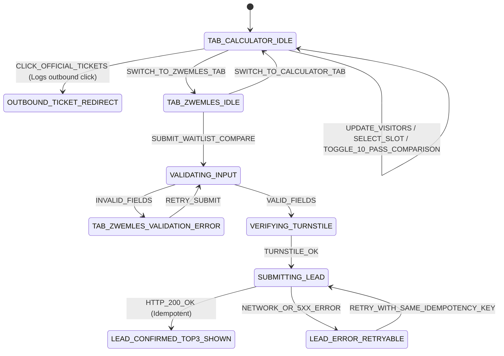

# Technical & Functional Specification: AlleZwembaden.nl (`001`)

* **Version:** 1.0 (Post-`/grill-me` Baseline)
* **Date:** 2026-10-21
* **Rigor Path:** **Full Path** ([`PHILOSOPHY.md`](file:///Users/sramzzs4d/Projects-sramzz/swimming/PHILOSOPHY.md): TDD, Full Layered Modeling, `database-context/`, Formal Specs & Plans, SCD/Grain Discipline, Finite State Machines, CQS, Idempotency)
* **Target Market:** The Netherlands (`nl-NL`)

---

## 1. System Vision & Core User Problems

**AlleZwembaden.nl** is a high-performance, read-heavy Dutch swimming directory and demand-generation platform solving four core problems:
1. **Directory, Water Disinfection & Pricing Clarity:** Transparent comparison of indoor/outdoor pools, single tickets (*losse entree*), multi-visit passes (*10-badenkaart*), monthly subscriptions, municipal discount passes (*Stadspas*, *U-pas*, *Ooievaarspas*), and skin-friendly water treatment (`Zoutelektrolyse` vs. `Klassiek Chloor` vs. `Natuurwater`).
2. **Reliable *Banenzwemmen* & Holiday Schedules:** Accurate weekly lane-swimming and recreational schedules that automatically account for **Dutch public holidays (*Feestdagen*)**, regional **school vacations (*Schoolvakanties Regio Noord, Midden, Zuid*)**, and **KNMI weather warnings (*Code Oranje / Rood*)**.
3. **Kids' Swim Lessons (*Zwem-ABC* Waitlists & Demand Capture):** Side-by-side comparison of *Diploma A, B, C* waitlists (*wachttijden*), NRZ/KNZB accreditation, and monthly pricing across municipal pools and commercial swim schools—paired with an honest Day-1 conversion flow (*Official Registration Link* + native *"Kortste Wachttijd Vergelijker & Alert"*).
4. **Open Water & Seasonal Transitions (+ Affiliate Gear Stub):** Tracking outdoor water temperatures and *blauwalg* warnings (`Rijkswaterstaat` / `Zwemwater.nl`) with a security-hardened stub for contextual gear recommendations.

---

## 2. Infrastructure, Cost Protection & DDoS Immunity

Ref: [MADR 0001](file:///Users/sramzzs4d/Projects-sramzz/swimming/docs/MADRs/0001-hosting-and-database-cloudflare-d1.md)

* **Primary Hosting:** **Cloudflare Pages + Cloudflare Workers + Cloudflare D1 (SQLite)** on the Free Tier (hard caps, zero pay-as-you-go runaway billing risk).
* **Static-First Delivery:** All indexable SEO routes are pre-rendered to static HTML at build time (`05:00 Europe/Amsterdam` daily scheduled build + on-demand data-diff builds). Static asset delivery on Cloudflare Pages is unlimited and free.
* **Edge Cache Shield for Dynamic Reads:** Any Worker/Server Island read endpoint (`/api/outdoor-conditions`, `/api/waitlist-comparison`) enforces `Cache-Control: public, s-maxage=1800, stale-while-revalidate=86400` so Cloudflare's CDN absorbs traffic spikes without hitting D1.
* **WAF + Turnstile Shield for Writes:** `POST /api/leads` and `POST /api/clicks` require a valid **Cloudflare Turnstile** token (for forms), strict **Zod** payload validation, **Cloudflare WAF Rate Limiting** (max 5 requests / 10 mins / IP), and an `idempotency_key`.

---

## 3. SEO & URL Architecture

Ref: [MADR 0002](file:///Users/sramzzs4d/Projects-sramzz/swimming/docs/MADRs/0002-frontend-seo-astro-islands-and-faceted-urls.md)

### 3.1 Two-Tier URL Taxonomy
1. **Homepage:** `/`
2. **Shallow Canonical Facility Detail Pages:** `/zwembad/[stad]/[slug]` (e.g., `/zwembad/amsterdam/de-mirandabad`)
   * Hierarchy (`Nederland › Noord-Holland › Amsterdam › De Mirandabad`) is rendered via visible breadcrumbs and `BreadcrumbList` JSON-LD.
3. **Tier-1 Indexable City & Intent Pages (Pre-rendered Static HTML):**
   * `/steden/[stad]` — City overview, map, and all venues in `[stad]`
   * `/steden/[stad]/banenzwemmen` — Consolidated weekly *banenzwemmen* timetable & *10-badenkaart* comparison
   * `/steden/[stad]/zwemles` — *Zwem-ABC* waitlist ranking table, NRZ licenses & monthly rates
   * `/steden/[stad]/buitenwater` — Open-air pools & natural open-water spots + water temperatures
   * `/provincies/[provincie]` — Province directory hub
4. **Tier-2 Non-Indexable UI Micro-Filters (Client Island):**
   * Query parameters (`?waterbehandeling=zout&nu_open=1&max_prijs=800&sort=wachttijd`) filter listings client-side without page reloads.
   * Every filtered state outputs `<link rel="canonical" href="https://allezwembaden.nl/steden/[stad]/[intent]">` to prevent crawl traps.

### 3.2 Zero Soft-404 Quality Gate
* During static generation, a Tier-1 route (`/steden/[stad]/[intent]`) is **only** emitted as an indexable page and included in `sitemap.xml` if `count(matching_venues_in_city_or_5km_radius) >= 1`.

### 3.3 Auto-Generated City Data Summaries & JSON-LD Schema.org
* Every Tier-1 City page computes deterministic summary facts in HTML + `FAQPage` JSON-LD (e.g., total venues, cheapest single ticket, shortest *Diploma A* waitlist, count of `Zoutelektrolyse` pools).
* Every Facility Detail page emits:
  * `SportsActivityLocation` / `PublicSwimmingPool` (`name`, `address`, `geo`, `aggregateRating`, `amenityFeature`, `openingHoursSpecification`, and `specialOpeningHoursSpecification` for upcoming verified holidays/vacations).
  * `AggregateOffer` (for admission tariffs) and `Course` (for *Zwem-ABC* offerings).

---

## 4. Design System & UI Component Architecture (`Aquatic Discovery`)

Ref: [`DesignMockups/light_theme_DESIGN_md_aquatic_discovery_light_theme/DESIGN.md`](file:///Users/sramzzs4d/Projects-sramzz/swimming/DesignMockups/light_theme_DESIGN_md_aquatic_discovery_light_theme/DESIGN.md) & [`DesignMockups/dark_theme_DESIGN_md_aquatic_discovery/DESIGN.md`](file:///Users/sramzzs4d/Projects-sramzz/swimming/DesignMockups/dark_theme_DESIGN_md_aquatic_discovery/DESIGN.md)

### 4.1 Token Contract (Tailwind CSS v4 `@theme`)
* **Typography:** `Plus Jakarta Sans` (`400`, `500`, `600`, `700`, `800`), tight negative tracking on headlines (`-0.01em` to `-0.02em`).
* **Light Theme Palette:**
  * Canvas/Surface: `#FFFFFF` (`surface-pure`), `#FCF9F8` (`surface`), `#F7F7F7` (`surface-subtle`), Borders `#EBEBEB` (`border-hairline`) & `#DDDDDD` (`border-strong`).
  * Text: `#222222` (`text-charcoal`), `#717171` (`text-muted`).
  * Primary Aquatic Teal: `#00696D` (`primary`) / `#008489` (`primary-container`), Badge BG `#E6F4F5` (`badge-teal-bg`).
  * Secondary Ocean Blue: `#006398` (`secondary`).
  * Seasonal / Alert Amber: `#F97316` (`accent-seasonal`), Badge BG `#FFF7ED` (`badge-amber-bg`).
* **Dark Theme Palette (`class="dark"`):**
  * Canvas `#0B1326` / `#0F172A`, Cards `#1E293B`, Hairline `#334155`, Primary Cyan `#4CD7F6` / `#06B6D4`, Text `#DAE2FD` / `#F8FAFC`.

### 4.2 Zero-JS Static Components vs. Interactive Preact/FSM Islands

| Component | Rendering Mode | JS Payload | Description |
| :--- | :--- | :--- | :--- |
| **Top Nav, Breadcrumbs, Footer, Trust Banner** | Static `.astro` | `0 KB` | KNZB/NRZ & Rijkswaterstaat trust strip, responsive navigation. |
| **5-Photo Hero Grid & Facility Highlights** | Static `.astro` | `0 KB` | Airbnb 5-tile photo grid, basin temperature cards (`31.2°C Golfslagbad`, `27.8°C 50m Bad`), `Zoutelektrolyse` badges, OV transit chips. |
| **Tarieven Table & Zwem-ABC 4-Phase Timeline** | Static `.astro` | `0 KB` | Versioned tariffs (`2025/2026`), *Stadspas* callout, 4-phase *Zwem-ABC* curriculum timeline. |
| **"Nu Open" Clock Highlighter** | Inline Vanilla TS | `< 1 KB` | Evaluates embedded schedule JSON against `Europe/Amsterdam` current time in 0 network requests. |
| **3-Segment Search Pill & Category/Filter Rail** | Preact Island (`client:idle`) | `~4 KB` | *Waar (Stad/PC4)*, *Wat zoek je (Banen/Les/Subtropisch/Buiten)*, *Waterbehandeling (Zoutelektrolyse/Chloor)*. |
| **Listing Split-View Map (`42%` Desktop / Mobile Drawer)** | Preact + MapLibre GL (`client:visible`) | Lazy | OpenFreeMap / PDOK vector tiles with custom HTML price/waitlist/temp pills & floating preview card ([MADR 0003](file:///Users/sramzzs4d/Projects-sramzz/swimming/docs/MADRs/0003-zero-cost-hybrid-mapping-architecture.md)). |
| **Detail Page Location Map (`#locatie`)** | Lazy `<iframe>` Facade | `0 KB` initial | Mounts free Google Maps Embed `<iframe>` only when scrolled into view or clicked. |
| **Sticky Calculator & Zwemles Lead Widget** | Preact + TS FSM Island (`client:visible`) | `~5 KB` | Dual-tab sticky widget (Desktop right column / Mobile bottom sheet). |

---

## 5. Finite State Machines (FSMs) & Business Logic

In accordance with [`PHILOSOPHY.md`](file:///Users/sramzzs4d/Projects-sramzz/swimming/PHILOSOPHY.md#L49), all stateful flows are modeled as explicit, pure TypeScript Finite State Machines in `src/machines/` and unit-tested with **Vitest (TDD)** before UI integration.

### 5.1 Sticky Widget & Lead Capture Frontend FSM (`stickyWidgetMachine`)

* **Tab 1 (`Vrijzwemmen / Banen` — Interactive Price Calculator):**
  * Computes total admission cost for selected visitor counts (*Volwassenen*, *Kinderen*) and compares against the venue's *10-Badenkaart* per-visit cost.
  * Displays municipal pass discount eligibility (*Stadspas*, *U-pas*).
  * Primary CTA (**"Koop Tickets / Reserveer bij Zwembad ↗"**) records an aggregated click in `outbound_click_daily_counts` and opens the pool's official ticketing page.
* **Tab 2 (`Zwemles Aanvraag / Wachtlijst-Alert` — Honest Day-1 Hybrid):**
  * Provides a direct **"Inschrijven op officiële website ↗"** link (tracked) **plus** the native **"Ontvang Top 3 Kortste Wachttijden in jouw buurt (+ Wachtlijst-Alert)"** form.
  * Collects AVG-minimal fields: `postcode_pc4`, `child_age_years`, `diploma_track`, `preferred_days`, `prefers_salt_water`, and `parent_email`.
  * Immediately returns the 3 shortest-waitlist *Zwem-ABC* offerings within 5–10 km of the parent's PC4 postcode and stores the demand signal in `lead_requests`.

### 5.2 Dutch Calendar, School Vacation & Weather Context Resolver (`scheduleResolverMachine`)

Every venue's displayed schedule and alert banner is resolved deterministically:
1. Check `weather_alerts` for the venue's `province_slug`:
   * If `knmi_code IN ('ORANJE', 'ROOD')` $\rightarrow$ Display high-visibility safety banner; if venue is outdoor/open-water, transition display state to `CLOSED_UNSAFE_OR_WEATHER`.
2. Check `outdoor_conditions` (for outdoor/open-water venues):
   * If `water_quality_state != 'CLEAN_APPROVED'` $\rightarrow$ Display official *Zwemwater.nl / Rijkswaterstaat* warning (*Blauwalg* / *Zwemmersjeuk*).
   * If `water_temp_celsius < 16.0` $\rightarrow$ Display seasonal cold-water wetsuit & swim-buoy advisory (`#FFF7ED` / `#F97316`).
3. Check `nl_public_holidays` and `nl_school_vacations` (matched to the venue's `municipality.school_vacation_region` — `noord`, `midden`, or `zuid`):
   * Look up `schedule_periods` covering `today` (ordered by `priority DESC`):
     * If `verification_state == 'VERIFIED_PUBLISHED'` $\rightarrow$ Render the verified holiday/vacation schedule + emit `specialOpeningHoursSpecification` in JSON-LD.
     * If `verification_state == 'UNCONFIRMED_FALLBACK'` during an active holiday/vacation $\rightarrow$ Render regular schedule with an explicit warning banner: *"⚠️ Let op: Het is momenteel [Vakantienaam] (Regio [Noord/Midden/Zuid]). Controleer het actuele vakantierooster op de website van het zwembad."*
   * Look up `schedule_periods` starting within the **next 14 days**:
     * If a future holiday/season period is `VERIFIED_PUBLISHED`, render an upcoming schedule preview tab (*"Binnenkort: [Herfstvakantierooster] vanaf [datum]"*).

---

## 6. Data Ingestion, Quarantine Gate & Observability

Ref: [MADR 0004](file:///Users/sramzzs4d/Projects-sramzz/swimming/docs/MADRs/0004-ingestion-cli-lightpanda-obscura-and-quarantine-gate.md) & [`docs/runbooks/local-scraper-recovery.md`](file:///Users/sramzzs4d/Projects-sramzz/swimming/docs/runbooks/local-scraper-recovery.md)

* **Portable TypeScript CLI (`pnpm sync`):**
  * **Step 1:** HTTP `fetch()` + `cheerio` (HTML) / JSON API / `unpdf` (PDF) (`~50 MB` RAM).
  * **Step 2:** `Lightpanda` (Zig, `~24 MB` RAM) or `Obscura` (Rust, `~30 MB` RAM) connected via Chrome DevTools Protocol (`playwright-core` `connectOverCDP`).
  * **Step 3:** Local Mac CLI execution (`pnpm sync:venue --slug=<slug> --push-d1`) or manual JSON override (`database-context/manual-overrides/<slug>.json`).
* **Idempotency & Sanity Invariants:**
  * Skip processing if `sha256(raw_payload) == last_verified_hash`.
  * Quarantine any scrape where adult single ticket is outside `€1.50–€35.00` (for paid pools), schedule slot count drops by `> 50%` unexpectedly, or required schema fields fail Zod validation.
* **Observability & Alerting:**
  * Dual logging to [`logs/`](file:///Users/sramzzs4d/Projects-sramzz/swimming/logs/) (`.log` human-readable + `.jsonl` structured) and D1 `ingestion_runs` / `quarantined_anomalies`.
  * Instant push notification via `ALERT_WEBHOOK_URL` (Telegram / Discord / Slack / ntfy.sh) with 24h per-venue/error deduplication cooldown.
  * `/api/health` endpoint verifying HTTP status, D1 connectivity, and sync freshness for Uptime Kuma / external uptime checks.
